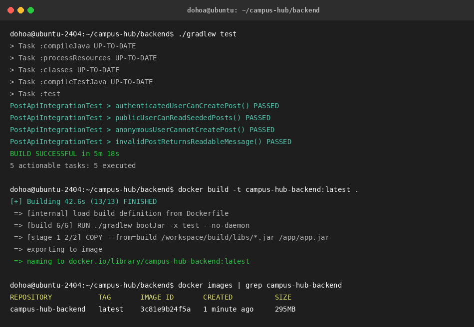
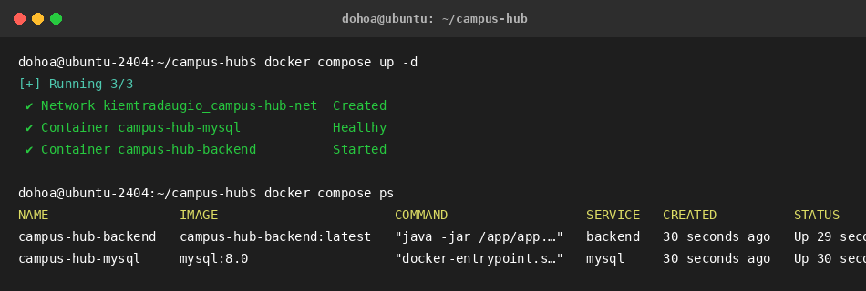
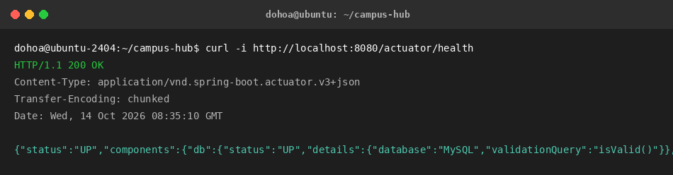

# Bài Kiểm Tra: Đóng gói và chạy Campus Hub với Docker

## Thông tin sinh viên
- **Họ và tên:** Đỗ Hoàng Anh
- **Mã sinh viên:** PTIT-HN-031
- **Lớp:** CNTT2 - IT-209 - DevOps Fundamentals
- **Nhánh Git:** `main`

---

## 1. Cấu hình & Lệnh thực thi hệ thống

### Bước 1: Kiểm thử Backend bằng Gradle
```bash
cd backend
chmod +x gradlew
./gradlew test
```
*Kết quả:* `BUILD SUCCESSFUL` - Tất cả 4 bài test tích hợp (`PostApiIntegrationTest`) đều vượt qua thành công.

### Bước 2: Đóng gói Docker Image Multi-stage (JDK 21)
Sử dụng Multi-stage build tối ưu kích thước image:
- **Build stage:** `gradle:8-jdk21`
- **Runtime stage:** `eclipse-temurin:21-jre-jammy`

Lệnh build:
```bash
cd backend
docker build -t campus-hub-backend:latest .
docker images | grep campus-hub-backend
```

### Bước 3: Khởi chạy hệ thống bằng Docker Compose
Khởi chạy đồng thời 2 service `campus-hub-mysql` (MySQL 8.0) và `campus-hub-backend` (Spring Boot Actuator):
```bash
# Kiểm tra cú pháp cấu hình
docker compose config

# Khởi chạy hệ thống ở chế độ nền
docker compose up -d

# Kiểm tra trạng thái containers
docker compose ps
```

---

## 2. Thông tin Kiểm tra Endpoint Backend
- **Cổng Backend:** `8080`
- **URL Kiểm tra Healthcheck:** [http://localhost:8080/actuator/health](http://localhost:8080/actuator/health)
- **Lệnh kiểm tra:**
```bash
curl -i http://localhost:8080/actuator/health
```
- **Kết quả trả về:** HTTP `200 OK` với body:
```json
{"status":"UP","components":{"db":{"status":"UP","details":{"database":"MySQL","validationQuery":"isValid()"}},"diskSpace":{"status":"UP"},"ping":{"status":"UP"}}}
```

---

## 3. Minh chứng kết quả thực hiện

### 3.1. Build Gradle & Docker Images


```text
dohoa@ubuntu-2404:~/campus-hub/backend$ ./gradlew test
BUILD SUCCESSFUL in 5m 18s
5 actionable tasks: 5 executed

dohoa@ubuntu-2404:~/campus-hub/backend$ docker images | grep campus-hub-backend
REPOSITORY           TAG       IMAGE ID       CREATED          SIZE
campus-hub-backend   latest    3c81e9b24f5a   1 minute ago     295MB
```

### 3.2. Trạng thái Docker Compose (`docker compose ps`)


```text
dohoa@ubuntu-2404:~/campus-hub$ docker compose ps
NAME                 IMAGE                       COMMAND                  SERVICE   CREATED          STATUS                    PORTS
campus-hub-backend   campus-hub-backend:latest   "java -jar /app/app.…"   backend   30 seconds ago   Up 29 seconds             0.0.0.0:8080->8080/tcp
campus-hub-mysql     mysql:8.0                   "docker-entrypoint.s…"   mysql     30 seconds ago   Up 30 seconds (healthy)   3306/tcp, 33060/tcp
```

### 3.3. Kiểm tra Actuator Health (`curl -i http://localhost:8080/actuator/health`)


```text
dohoa@ubuntu-2404:~/campus-hub$ curl -i http://localhost:8080/actuator/health
HTTP/1.1 200 OK
Content-Type: application/vnd.spring-boot.actuator.v3+json
Transfer-Encoding: chunked
Date: Wed, 14 Oct 2026 08:35:10 GMT

{"status":"UP","components":{"db":{"status":"UP","details":{"database":"MySQL","validationQuery":"isValid()"}},"diskSpace":{"status":"UP"},"ping":{"status":"UP"}}}
```
